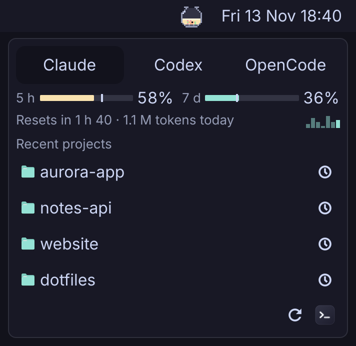

# Bowl

A little fish for KDE Plasma 6. Open Claude Code, Codex or OpenCode in a terminal from the
panel, and watch its bowl empty as your subscription quota goes.



- **The fish**: a little fish swims in its round bowl, in pixel art and the colors of
  [Catppuccin Mocha](https://catppuccin.com/palette). The water is your quota: 9 rows that
  go down as you use it, teal while more than half is left, then yellow, peach from a
  quarter, and red near the end. It swims and blows bubbles at rest, darts about
  with a trail of bubbles while an agent is at work, lingers near the bottom when a quarter
  is left, falls asleep on the pebbles after half an hour without any, and comes up to the
  surface under the mouse. When the quota runs out, the bowl is dry and it leaps out of it.
  A middle click opens the agent in your terminal, in the last
  project it worked on, with its usual permissions. If it fails at once, the window stays
  open so that you can read why.
- **The popup**, on click:
  - a tab for each agent installed, which also picks the agent that opens. Drag a tab to
    change the order;
  - the agent's recent projects, to start a new session in one or resume its last one
    (the right-click menu lists them too);
  - the agent's limit windows, in the colors of the water, each with a tick for how much of the window has gone by.
    A bar ahead of its tick means you are going faster than the pace, and a warning tells
    you when the quota would run out before the reset;
  - today's tokens, and the last 7 days.
- **Subscriptions only**: Bowl opens the agents' own command-line tools, signed in as
  they are. The terminal it opens for Claude Code leaves out the API key variables of your
  environment. OpenCode runs with whatever it is configured with.

In English and French.

## Requirements

- Plasma 6 and Python 3, nothing else.
- At least one of these, installed and signed in:
  - [Claude Code](https://github.com/anthropics/claude-code), with a Claude subscription;
  - [Codex](https://github.com/openai/codex), with a ChatGPT account;
  - [OpenCode](https://opencode.ai).

  Only the installed ones get a tab.

## Install

```sh
git clone https://github.com/elomkdn/bowl.git
cd bowl
./install.sh
```

Then right-click a panel, *Add Widgets…*, **Bowl**.

To update: `git pull`, `./install.sh`, then log out and back in. To remove:
`./install.sh --uninstall`. `./dist.sh` builds `dist/bowl.plasmoid`, a file that
installs offline.

## How the usage is measured

| Agent | Limits | Tokens |
|---|---|---|
| Claude Code | The 5-hour and 7-day windows of Claude Code's `/usage`, and a model's own window when there is one (in the tooltip of the matching bar) | Claude Code's transcripts, in `~/.claude/projects`, cache reads excluded |
| Codex | The windows Codex records in its sessions, when your plan reports them. When a session hits the limit, the date it comes back | Codex's sessions, in `~/.codex/sessions` |
| OpenCode | None | OpenCode's database, and today's cost |

Claude's windows come from Anthropic, the way Claude Code's `/usage` gets them, with the
sign-in Claude Code keeps in `~/.claude/.credentials.json`. Reading them uses no quota.
Bowl checks every 5 minutes while Claude Code is in use on this computer, and every
15 minutes otherwise, so that what you do on other devices or on the web shows up too.

Only Claude Code renews its sign-in, when it runs. If it has lapsed, the last windows stay
on show, and the refresh button sends a minimal request to Haiku instead (about 700
tokens, with no session saved), which renews it.

## Privacy

Bowl reads local files and opens the agents' tools. By itself, it only sends Claude
Code's sign-in to Anthropic to read your windows, plus the Haiku request above when you
ask for it. Its state lives in `~/.cache/bowl`, readable by you only.

## Limits

It reads the JSON output of the agents' tools, and some of it is undocumented. An update
of one of them can break the display. Tested with Claude Code 2.1.318 on a Pro plan,
Codex 0.166.0, OpenCode 2.2.5 and Plasma 6.8.

## Translations

`po/extract.py` writes `po/template.pot` from the interface. To update a catalog:
`msgmerge --update --no-wrap po/fr.po po/template.pot`. For a new language, copy
`po/fr.po` to `po/<language>.po`, translate it, and add it to `install.sh` and `dist.sh`.

## Not affiliated

Bowl is an independent project. It is not affiliated with, or endorsed by, Anthropic,
OpenAI, the OpenCode project or Catppuccin, whose palette it borrows (MIT). Claude, Claude Code, Codex, ChatGPT and OpenCode belong to
their respective owners.

## License

[GPL-3.0-or-later](LICENSE).
